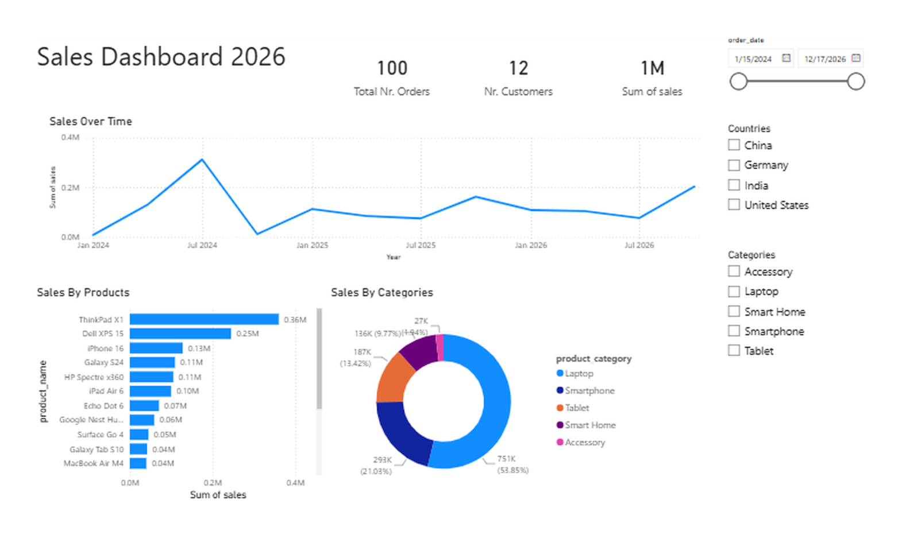
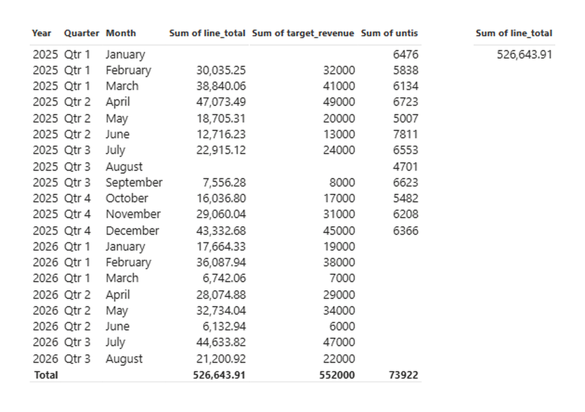

<div align="center">

# Power BI Tutorial

**From a first dashboard to a finished star-schema model — six hands-on Power BI lessons.**

Importing data · Power Query · Data modeling · DAX

</div>

---

## What you'll build

| Lesson 01 — My First Dashboard | Lesson 05 — Project: Clean Model |
| :---: | :---: |
|  |  |
| KPI cards, sales over time, top products, a category donut, and slicers for date, country and category. | A clean star schema of `dim_*` and `fact_*` tables driving a Year / Quarter / Month actual-vs-target report. |

---

## Lessons

| # | Folder | Topic | What you learn |
| :-: | --- | --- | --- |
| 01 | [`datasets/01_first_dashboard`](datasets/01_first_dashboard) | First dashboard | Importing data, KPI cards, line / bar / donut charts, slicers |
| 02 | [`datasets/02_connection_types`](datasets/02_connection_types) | Connection types | Import vs DirectQuery vs Live Connection, and when each one fits |
| 03 | [`datasets/03_power_query`](datasets/03_power_query) | Data cleaning | Shaping messy data in Power Query before it reaches the model |
| 04 | [`datasets/04_data_modeling`](datasets/04_data_modeling) | Data modeling | Fact and dimension tables, relationships, star schema design |
| 05 | [`datasets/05_project_clean_model`](datasets/05_project_clean_model) | Project: clean model | Cleaning and modeling combined into one end-to-end model |
| 06 | [`datasets/06_dax`](datasets/06_dax) | DAX | Writing measures and calculations |

> **Workbooks:** the openable `.pbix` files live in [`powerbi_files/`](powerbi_files) — `My First Dashboard`, `Data Cleaning (Power Query)`, `Data Modeling` and `Project Clean Model`.

---

## Repository layout

```text
powerbi-tutorial/
├── asset/                          # screenshots used in this README
│   ├── sales-dashboard.png
│   └── clean-model-report.png
├── datasets/                       # lesson data, one folder per lesson
│   ├── 01_first_dashboard/
│   ├── 02_connection_types/        # including 12 monthly sales files
│   ├── 03_power_query/
│   ├── 04_data_modeling/           # dim_* / fact_* sample tables
│   ├── 05_project_clean_model/
│   └── 06_dax/
├── powerbi_files/                  # the four .pbix workbooks
└── project_nightmare_datamodel/    # larger sample dataset + project model
```

---

## Getting started

1. Install [Power BI Desktop](https://powerbi.microsoft.com/desktop/) — Windows only.
2. Clone the repository:

   ```bash
   git clone https://github.com/mashraf02/power-bi-tutorial.git
   ```

3. Open the workbook in `powerbi_files/` that matches the lesson.
4. If Power BI asks for a data source, point it at the matching file in `datasets/` (for the full project model, `project_nightmare_datamodel/dataset.xlsx`):

   **Home → Transform data → Data source settings → Change Source**

---

## The data

`datasets/` holds the sample data used across the lessons: monthly sales extracts, orders and customers, product prices, an events log and a SQL Server schema, plus the `dim_*` / `fact_*` tables used for modeling.

`project_nightmare_datamodel/dataset.xlsx` is the larger business dataset — orders, order line items, customers, products, shipments, invoices, payments, campaigns, inventory and sales targets — deliberately a little messy, so there is something real to clean.

---

## Tools

- **Power BI Desktop** — reports and models
- **Power Query (M)** — data transformation
- **DAX** — measures and calculations
- **Excel** — data source

---

## Author

**Mashraful** — Computer Science, Independent University Bangladesh (IUB)
